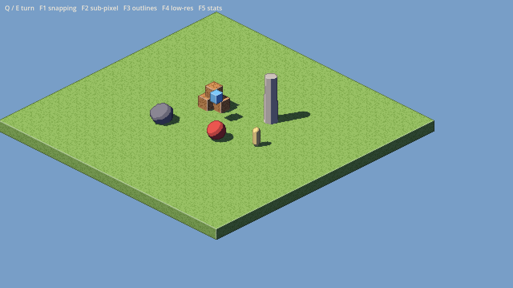

# Pixelizer



Real 3D scenes that look like pixel art, as one Godot addon. Pixelizer renders your 3D world small and shows it
upscaled by a whole number with hard pixels (about 640×360), moves the camera in whole pixels so nothing shimmers,
lights surfaces in a few flat toon bands and draws one-pixel outlines. 16 px per metre.

- **`PixelViewport`**: low-res render, whole-number upscale, a hidden 1 px margin and a sub-pixel shift, so the
  camera can glide smoothly while every edge stays on the pixel grid. Maps the mouse to low-res pixels.
- **`PixelCameraRig`**: orthographic camera snapped to the pixel grid in camera space; 90° turns, pitch, follow,
  cutaway, shake in whole pixels, and a planet mode where "up" points away from a centre.
- **Toon shaders**: banded light with tinted shadows, world-aligned texels so every surface has the same pixel
  density, and variants for faceted models and stair-like shapes.
- **Outline pass**: dark, slope-aware silhouettes and light crease lines, one low-res pixel wide, controlled per
  surface with stencils and per pixel with roughness marks.
- **`pixel_stage.tscn`**: all of it wired together. Drop it in and put your world under it.
- Extras: `PixelBob` (bobs in whole pixels), `DebugOverlay` (F1–F5 toggle each stage), `EditorTheme` (a flat UI
  theme sized in art pixels).

**Needs** Godot **4.7 .NET** (C#) with the **Forward+** renderer (the outline pass reads the normal-roughness
buffer), and the .NET 8 SDK or newer.

## Install

- **From the Godot Asset Store**: find *Pixelizer*, download, install. It lands in `addons/pixelizer/`.
- **By hand**: copy `addons/pixelizer/` from this repository (or from a release zip) into your project.
- **With the script**, which also adds the two project settings the look needs:

  ```sh
  python3 tools/install.py <path/to/your/project>
  ```

Then build the C# solution (the hammer in the editor, or `dotnet build`). There is no editor plugin to enable: the
nodes are plain C# classes. How to set up a scene, the shaders, the outline stencils and the rules that keep it pixel
art: [addons/pixelizer/README.md](addons/pixelizer/README.md).

## Run the demo

```sh
dotnet build
godot --path .
```

`demo/demo.tscn` puts a few code-built shapes through the pipeline: textured ground, crates, a pillar, a ball, a
faceted rock without crease lines, a cube bobbing in whole pixels, and a walker the camera follows. Q / E turn the
camera; F1–F4 switch snapping, sub-pixel smoothing, outlines and low-res off and on; F5 shows the frame stats.
`-- --shot=<file.png>` saves the window after half a second and quits.

## Keeping several projects on one copy

This repository is the master copy; we run it in our own games (a map builder, a character maker and the games
made with them), and each carries a copy it never edits. To change the look:

1. Edit `addons/pixelizer/` here and check it in the demo.
2. Refresh the projects:

   ```sh
   python3 tools/install.py ../game-one ../game-two
   ```

   It replaces each project's `addons/pixelizer` and adds the project settings the look needs when the project
   doesn't set them (hard shadows, nearest-filtered decals). Settings a project already has are left alone.
3. Build and look at each project.

## Releasing

Add the version on top of [addons/pixelizer/CHANGELOG.md](addons/pixelizer/CHANGELOG.md), commit, then:

```sh
python3 tools/package.py
```

It writes `dist/pixelizer-<version>.zip` holding `addons/pixelizer/` as committed: the file to upload as a new
version on the Asset Store. What goes in the store listing: [docs/asset-store-listing.md](docs/asset-store-listing.md).

## Credits

Pixelizer follows the 3D pixel-art approach [t3ssel8r](https://www.youtube.com/@t3ssel8r) showed the world, and owes
thanks to Eduardo Schildt, JorisAR and the Godot contributors. Who did what:
[addons/pixelizer/CREDITS.md](addons/pixelizer/CREDITS.md).

## License

MIT, © 2026 [mapo works](https://mapo.works). See [LICENSE](LICENSE).
